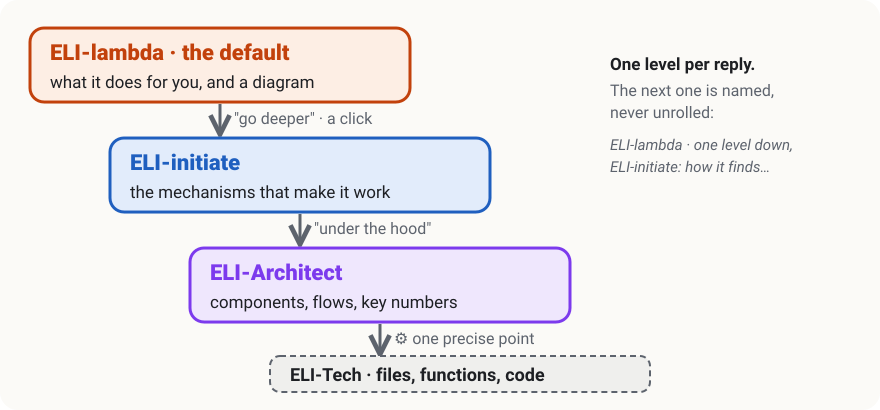

# eli

**Claude explains top-down, one level at a time. Plain words and a diagram first, then the
technical detail when you ask for it, in one word.**



Subjects are often big and tangled. Diving into all the technical detail at once makes them hard
to get into, so eli gives Claude and you a shared vocabulary of named levels (ELI is short for
*Explain Like I'm…*):

| Level | Explain like I'm… | What you get |
|---|---|---|
| ELI5 | a curious child | one everyday image |
| **ELI-lambda**, the default | anyone of normal intelligence, new to the subject | what it does for you, and a diagram |
| ELI-initiate | interested and willing to learn | the mechanisms that make the idea possible and convenient |
| ELI-Architect | the person who designs the solution | components, flows, trade-offs, the numbers that constrain |
| ELI-Tech | the person who implements it | files, functions, commands, code |

- **Claude guesses the level** from your message: a new subject starts at ELI-lambda, a question
  about a file goes to ELI-Tech, a proposed design goes to ELI-Architect, "go deeper" goes one
  notch down. The level is sticky: it follows the subject, not each message.
- **You can always name one**: "ELI-archi: how would the cache work?"
- **Every explaining reply ends with a level line** that says which level it chose and what one
  notch down would hold, so a wrong guess is corrected in one word.
- **ELI-lambda means a diagram** whenever a new idea comes in: a picture is how a new idea gets
  into a brain. A plain factual answer stays one line.
- **Documents follow the same model**: a one-screen surface in plain words whose every element
  opens, on click, a zoom with the mechanisms; each zoom has an "Under the hood" section at the
  ELI-Architect level, with ELI-Tech inserts where a precise point needs one.

## What you get

| Piece | What it does |
|---|---|
| the **eli** output style | the levels, how to pick one, the forms (diagram before prose, tables for comparisons), the level line, and a "TO DO" block that ends a reply with what is left to do |
| the **`eli:documents`** skill | how a document carries the levels, with a ready template: light and dark, phone width, keyboard, links that open a precise level (`#a-2`) |
| the **eli-document** check | sends the session back to a document it just wrote when it is Markdown or has no visual, and warns when it lacks its levels, loads from the network, or holds too much prose per picture |

It pairs well with [docpin](https://github.com/elphono/docpin), which lets you pin notes on the
documents a session writes and sends them back to it. The template is built to work under
docpin's notes. Neither needs the other. eli replaces docpin's optional **visual-first** plugin,
style and check alike: if you had it, disable it (`/plugin disable visual-first@docpin`), or every
document is checked twice.

## Install

1. In a Claude Code session, type:

   ```text
   /plugin install eli --marketplace elphono/eli
   ```

2. Pick **eli:eli** in `/output-style`.
3. **Start a new session**: an output style is read when a session starts.

To try it, ask *"how does HTTPS keep my password secret?"*, then *"go deeper"*, then
*"ELI-tech"*.

## Before you start

- **Claude Code** 2.1.275 or later.
- **Python 3.12 or newer**, available as `python3`, for the document check. It installs no
  package.

## How a document is checked

The check runs after each `Write` or `Edit` of a page that counts as a document: one under a
`docs/` folder of the project, or, when docpin is installed, whatever docpin tracks. READMEs,
`CLAUDE.md`, working notes (`plans/`, `drafts/`) and figure sources (`figures/`) are never
checked.

| The document | Verdict |
|---|---|
| Markdown, or an HTML page with no visual (`svg`, `img`, `canvas`, `table`) | **blocked**: the session reworks it before moving on |
| no ELI-lambda surface or no ELI-initiate zoom (`data-eli` attributes, never the text) | warning |
| loads a script, a stylesheet or an image from the network | warning |
| more than 4 paragraphs per visual, or a new image over 1 MB | warning |

`touch ~/.claude/eli-off` turns the check off on a machine. A page whose form is justified, such
as a transcript, opts out with this in its first five lines:

```html
<!-- eli: exemption — a raw transcript -->
```

## Develop

```text
uv sync
uv run pytest -q
uv run ruff check hooks tests tools
```

## License

MIT
